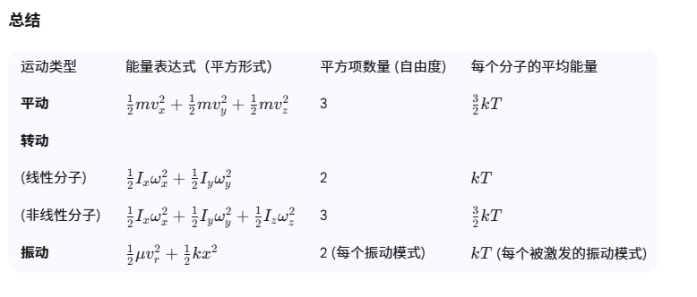

# MiMo 相册 · iCloud 照片智能管理原型

<p align="left">
  
  
  
</p>

> 一个能真正打开、能点的相册 PWA 原型：把散落在 iCloud Drive 里的照片，整理成可以按时间线浏览、按分类筛选、按标签搜索的相册。



---

## 为什么做这个

iPhone 用户把照片存进 iCloud Drive 后，只能通过「文件」App 一张张翻：没有时间线，没有分类，不能搜索，也看不出哪些是重复拍的。

想做的是把这堆**非结构化的图片文件**，变成一个**有组织、可检索的相册**。这个仓库是第一版界面与流程的实现。

## 先说清楚：这是什么，不是什么

| | 说明 |
|---|---|
| ✅ 是 | 高保真相册 PWA 交互原型，纯前端，双击 `prototype/index.html` 就能跑 |
| ✅ 是 | 导入、浏览、分类、打标签、搜索、去重流程、统计……界面上的操作都能真实完成 |
| ❌ 不是 | 不是接了大模型的生产系统。分类结果来自内置演示数据，去重是**流程模拟**（进度条按步骤推进），不会真的调用模型或向量库 |

项目名的「MiMo」来自最初设想的���模态模型接入方案。**当前版本没有接真实模型**，把它当成设计和流程验证的原型看更准确。

## 已经能用的功能

- **导入照片** — 从本地文件选择，读取为 Blob 并生成缩略图，写入本地索引
- **浏览** — 时间线、我的相册、收藏、回收站
- **组织** — 按分类归档（人物 / 风景 / 美食 / 文档 / 宠物…）、自定义标签、多选批量操作
- **搜索** — 关键词搜索 + 热门标签快捷入口
- **整理重复** — 三阶段去重流程：指纹计算 → 相似分组 → 逐张对比决定保留或删除，支持并排比较
- **图片编辑** — 裁剪、滤镜、拼图
- **数据看板** — 月度上传趋势、分类分布、存储构成
- **体验细节** — Material Design 3 视觉体系、指纹解锁界面、PWA 可安装到桌面、快捷键支持

`prototype/images/` 里有 36 张界面截图，可以直接当设计稿翻阅。

## 技术实现

```
prototype/
├── index.html      # 全部功能：结构 + 样式 + 逻辑内联，约 390 KB，无构建、无依赖
├── manifest.json   # PWA 清单（名称、图标、主题色）
├── sw.js           # Service Worker，支持离线启动
└── images/         # 36 张界面截图
```

- **零依赖**：不引任何 CDN 或框架，`<script>` 全部内联，断网也能打开
- **数据落地**：照片索引与相册结构存在浏览器 `localStorage`，照片本体以 Blob URL 渲染
- **可安装**：manifest + service worker，Safari/Chrome 均可「添加到主屏幕」
- **演示数据**：首次进入会载入一组示例照片与标签，用于展示分类与统计效果

## Roadmap（尚未实现）

- [ ] 接入多模态模型，做真实的图像分类与 OCR 文字提取
- [ ] 用向量索引替换关键词匹配，实现真正的语义搜索（「去年在海边拍的日落」）
- [ ] 落地真实的 pHash 计算与相似度打分
- [ ] 解析真实 EXIF，做时间线与地图定位
- [ ] 从 localStorage 迁移到 IndexedDB，支撑更大照片量

## 关于构建方式

产品定义、交互流程与视觉设计由本人完成；代码通过 AI 编程工具生成，并经过多轮调试与修改。这个项目的重点在**把需求拆解成可验证的界面流程**，而不是手写工程代码。

## 快速开始

```bash
git clone https://github.com/voania/mimo-smart-album.git
open prototype/index.html       # macOS
# 或直接双击 prototype/index.html
```

建议在浏览器里按 `F12` 切换到移动视图（iPhone 尺寸）查看，界面是按手机屏设计的。

---

<sub>个人项目 · 用于练习产品设计与 AI 工具协作，非商业项目</sub>
